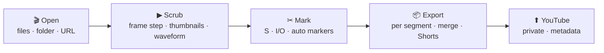
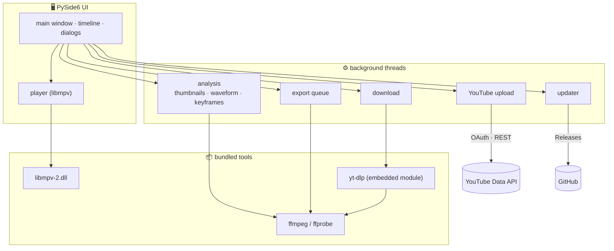

# ClipSlicer

[](https://github.com/vtubeadmirer/clipslicer/actions/workflows/ci.yml) [](https://github.com/vtubeadmirer/clipslicer/releases) [](https://github.com/vtubeadmirer/clipslicer/releases/latest)

[한국어](README.md) · **English**

A lightweight Windows video cutter. Watch a long video, drop a marker wherever you think **"cut here"**, and every segment is saved as its own file.
Pull clips out of stream VODs and lectures, turn them into Shorts, and upload them to YouTube, all in one program.

- No installer, fully portable (copy the folder to a USB stick and it still runs)
- Cuts without re-encoding by default, so it finishes **in seconds** with zero quality loss
- Built on ffmpeg, libmpv and PySide6, so it plays and edits nearly every format

> UI available in Korean and English (Settings ▸ Language; follows the system language by default).



## Download

Grab `ClipSlicer-vX.Y.Z-win64.zip` from [Releases](https://github.com/vtubeadmirer/clipslicer/releases/latest), unzip, run `ClipSlicer.exe`.
Windows 10 (1809+) / 11, 64-bit. If SmartScreen warns on first launch, choose **More info → Run anyway**.

When a new version is published, an **⬆ update** button appears inside the app; one click downloads, verifies, swaps the files and restarts.

## 30-second tour

1. Drag a video into the window (several files, a folder, or a YouTube/Chzzk URL via `Ctrl+L`)
2. Play, and press **`S`** where you want to cut. A red marker appears and the timeline splits into segments.
   - To pull out just the good parts: **`I`** at the start, **`O`** at the end. Only that range stays on; everything else is turned off.
3. `Ctrl+click` a segment to turn it off
4. **`Ctrl+E`**. Every enabled segment is saved as `name_01.mp4`, `name_02.mp4`, …

## Features

| Area | What you get |
|---|---|
| Cutting | Split mode (`S`), clip mode (`I`/`O`), frame stepping, undo/redo, auto-saved project files (`.clipslicer.json`) |
| Timeline | Thumbnail strip, audio waveform, keyframe marks, `Ctrl+wheel` zoom, hover preview, analysis cache |
| Auto markers | Silence detection, scene-change detection, paste timestamps (YouTube chapters, comments) |
| Output | Fast (lossless copy), Smart (re-encode only the first second), Precise (full re-encode), **vertical 9:16 Shorts**, audio only (m4a/mp3), merge segments, filename patterns, GPU encoding (NVENC/QSV/AMF) |
| Import | **Open from URL** with built-in yt-dlp: YouTube, Chzzk, Twitch and more; download only a time range of long VODs |
| Publish | **YouTube upload** of the cut files to your connected channel as private videos (title, description, tags, thumbnail, playlist, resumable, pre-upload limit checks), copy chapter list, save current frame as PNG |
| Ops | Update notifications with self-replacement, error log and dialogs, compatibility mode for GPU-less machines, portable settings (`settings.ini`) |

The full manual is in **[docs/index.html](docs/index.html)** (Korean) and in the in-app help (`F1`).

## Why three cutting modes

Compressed video stores a complete picture only every few seconds (a keyframe). Cutting without re-encoding therefore starts at the previous keyframe, usually 1–2 s early.

```
keyframes     K·····K·····K·····K·····
cut here            │
Fast          K═════│═══════════      ← starts at the previous keyframe (extra lead-in)
Smart             ▓▓▓K═══════════     ← only ▓ is re-encoded, the rest is copied
Precise           ▓▓▓▓▓▓▓▓▓▓▓▓▓▓     ← everything re-encoded
```

| Mode | Speed | Start point | Quality |
|---|---|---|---|
| **Fast** (default) | instant | pulled back to the previous keyframe | untouched |
| Smart | fast | frame-accurate | only the first 1–2 s re-encoded |
| Precise | slow | frame-accurate | full re-encode (CRF 18) |

Fast is enough most of the time; use Smart when the shifted start bothers you.

## Shortcuts

| Key | Action |
|---|---|
| Space / K | Play / pause |
| ← → · Shift+← → · Ctrl+← → | 1 frame · 1 s · 10 s |
| S | Cut marker |
| I / O | Clip start / end |
| E | Toggle current segment |
| Delete | Delete nearest marker |
| Ctrl+Z / Ctrl+Y | Undo / redo |
| R / L | Loop ±2 s around cursor / loop current segment |
| ↑ ↓ | Previous / next segment |
| Ctrl+wheel / Ctrl+0 | Zoom timeline / fit |
| Ctrl+Shift+M / Ctrl+Shift+S / Ctrl+Shift+V | Auto markers: silence · scene change · timestamps |
| Ctrl+L / Ctrl+U / Ctrl+P | Open from URL / upload to YouTube / save frame as PNG |
| Ctrl+E | Export all |
| F1 | Help |

## About YouTube upload

Two limits come from the YouTube API itself:
- Videos uploaded through a personal, unverified Google Cloud project are **locked to private**. ClipSlicer fills in all metadata; you flip the visibility in YouTube Studio.
- The default API quota allows roughly **6 uploads per day**, regardless of file size or length.

You create a free OAuth client in Google Cloud Console once (about 10 minutes); the in-app settings dialog walks you through it.

## Architecture



## Run from source · build

```
git clone https://github.com/vtubeadmirer/clipslicer
cd clipslicer
pip install -r requirements.txt
python tools\get_ffmpeg.py        # bin\ffmpeg\  (shared build, pinned version)
python tools\get_libmpv.py        # bin\libmpv-2.dll  (needs 7-Zip or Bandizip)
python main.py
```

Build the exe with `.\build.ps1` → `dist\ClipSlicer\`. Pushing a `vX.Y.Z` tag makes GitHub Actions build and attach the zip plus its SHA-256 to a release.

```
main.py              entry point
app/mainwindow.py    main window
app/player.py        libmpv player widget
app/timeline.py      timeline widget
app/segments.py      marker/segment model, undo, project files
app/ffmpeg_tools.py  analysis, cutting, merging (ffmpeg)
app/workers.py       background jobs (analysis, export, download)
app/youtube.py       YouTube OAuth + upload   app/youtube_ui.py  upload dialogs
app/updater.py       update check and self-replacement
app/hls_section.py   HLS range download       app/ytdlp_patches.py  yt-dlp fixes
tests/               unit and integration tests (run in CI)
docs/index.html      user manual (Korean)
```

## Troubleshooting

Errors are written to `logs\clipslicer.log` and unhandled ones are shown in a dialog (Help ▸ Open log folder).
If the video area stays black (remote desktop, VMs), enable **Compatibility mode** in Settings and restart.
Please attach the log when opening an [issue](https://github.com/vtubeadmirer/clipslicer/issues).

## License

MIT. Bundled components keep their own licenses: ffmpeg (GPL), libmpv (GPL), yt-dlp (Unlicense), PySide6 (LGPL).
