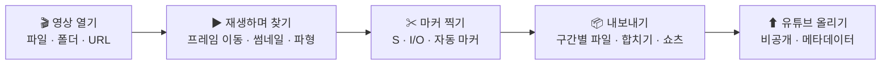
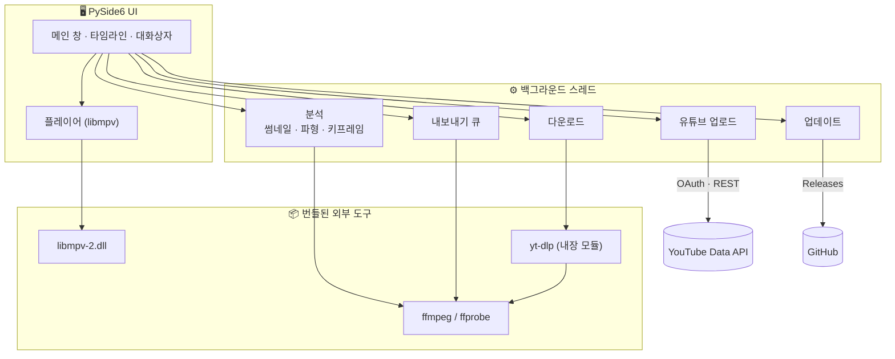

# ClipSlicer

[](https://github.com/vtubeadmirer/clipslicer/actions/workflows/ci.yml) [](https://github.com/vtubeadmirer/clipslicer/releases) [](https://github.com/vtubeadmirer/clipslicer/releases/latest)

**한국어** · [English](README.en.md)

긴 영상을 보다가 **"여기서 자르자"** 하는 지점에 마커만 찍으면, 구간별로 잘라 각각 저장해 주는 Windows 용 영상 자르기 도구입니다.
방송·강의 다시보기에서 클립을 뽑고, 쇼츠로 만들고, 유튜브에 올리는 것까지 한 프로그램에서 끝납니다.

- 설치 없음, 포터블 (폴더째 USB 에 복사해도 동작)
- 재인코딩 없이 원본을 그대로 끊어 내므로 **수 초 안에** 끝나고 화질 손실이 없음
- ffmpeg · libmpv · PySide6 로 만들었고, 거의 모든 영상 포맷을 재생·편집



## 다운로드

[Releases](https://github.com/vtubeadmirer/clipslicer/releases/latest) 에서 `ClipSlicer-vX.Y.Z-win64.zip` 을 받아 압축을 풀고 `ClipSlicer.exe` 를 실행합니다.
Windows 10 (1809 이상) / 11, 64비트. 처음 실행 때 SmartScreen 경고가 뜨면 **추가 정보 → 실행**.

새 버전이 나오면 프로그램 안에 **⬆ 새 버전** 버튼이 뜨고, 누르면 받아서 교체·재실행까지 자동으로 끝납니다.

## 30초 사용법

1. 영상을 창에 끌어다 놓기 (여러 개, 폴더, 또는 `Ctrl+L` 로 유튜브·치지직 URL)
2. 재생하다가 자를 지점에서 **`S`** — 빨간 마커가 생기고 타임라인이 구간으로 나뉨
   - 쓸 부분만 뽑을 땐 시작에서 **`I`**, 끝에서 **`O`** — 그 사이만 켜지고 나머지는 꺼짐
3. 필요 없는 구간은 `Ctrl+클릭` 으로 끄기
4. **`Ctrl+E`** — 켜진 구간이 `원본이름_01.mp4`, `_02.mp4` … 로 저장됨

## 기능

| 분류 | 내용 |
|---|---|
| ✂ 자르기 | 자르기 모드(`S`) · 클립 모드(`I`/`O`) · 프레임 단위 이동 · 실행 취소 · 작업 자동 저장(`.clipslicer.json`) |
| 📊 타임라인 | 썸네일 띠 · 오디오 파형 · 키프레임 표시 · `Ctrl+휠` 확대 · 호버 썸네일 미리보기 · 분석 결과 캐시 |
| 🤖 자동 마커 | 무음 구간 · 장면 전환 · 타임스탬프 텍스트 붙여넣기(유튜브 챕터·댓글) |
| 📦 출력 | 빠르게(무손실 복사) · 스마트(시작점만 재인코딩) · 정확하게(전체 재인코딩) · **세로 9:16 쇼츠** · 오디오만(m4a/mp3) · 구간 합치기 · 파일명 규칙 · GPU 인코딩(NVENC/QSV/AMF) |
| 🌐 가져오기 | **URL 에서 열기** — yt-dlp 내장. 유튜브 · 치지직 · 트위치 등, 긴 다시보기는 **구간만 받기** |
| ⬆ 올리기 | **유튜브 업로드** — 잘라낸 파일을 연결한 채널에 비공개로 올리기(제목·설명·태그·썸네일·재생목록, 이어 올리기, 한도 사전 검사) · 챕터 목록 복사 · 현재 화면 PNG 저장 |
| 🛠 운영 | 업데이트 알림·자동 교체 · 오류 로그·대화상자 · 호환 모드(GPU 없는 환경) · 포터블 설정(`settings.ini`) |

자세한 설명은 **[사용 설명서 (docs/index.html)](docs/index.html)** 또는 프로그램 안 도움말(`F1`)에 있습니다.

## 자르기 방식 — 왜 세 가지인가

압축 영상은 몇 초마다 한 장(키프레임)만 온전히 저장하기 때문에, 재인코딩 없이 자르면 시작점이 바로 앞 키프레임까지 당겨집니다(보통 1~2초).

```
키프레임      K·····K·····K·····K·····
자를 지점           │
빠르게        K═════│═══════════      ← 앞 키프레임부터 (앞에 여분이 붙음)
스마트            ▓▓▓K═══════════     ← ▓ 만 새로 인코딩, 나머지 복사
정확하게          ▓▓▓▓▓▓▓▓▓▓▓▓▓▓     ← 전부 새로 인코딩
```

| 방식 | 속도 | 시작점 | 화질 |
|---|---|---|---|
| **빠르게** (기본) | 즉시 | 앞 키프레임까지 당겨짐 | 원본 그대로 |
| 스마트 | 빠름 | 프레임 단위 정확 | 앞 1~2초만 재인코딩 |
| 정확하게 | 느림 | 프레임 단위 정확 | 전체 재인코딩 (CRF 18) |

대부분 **빠르게**로 충분하고, 시작점이 밀리는 게 거슬릴 때만 스마트를 쓰면 됩니다.

## 단축키

| 키 | 동작 |
|---|---|
| Space / K | 재생 · 정지 |
| ← → · Shift+← → · Ctrl+← → | 1프레임 · 1초 · 10초 이동 |
| S | 자르기 마커 |
| I / O | 클립 시작 / 끝 |
| E | 현재 구간 켜기/끄기 |
| Delete | 가까운 마커 삭제 |
| Ctrl+Z / Ctrl+Y | 실행 취소 / 다시 실행 |
| R / L | 앞뒤 2초 돌려보기 / 구간 반복 |
| ↑ ↓ | 이전 / 다음 구간 |
| Ctrl+휠 / Ctrl+0 | 타임라인 확대 / 전체 보기 |
| Ctrl+Shift+M / Ctrl+Shift+S / Ctrl+Shift+V | 무음 · 장면 전환 · 타임스탬프 자동 마커 |
| Ctrl+L / Ctrl+U / Ctrl+P | URL 에서 열기 / 유튜브에 올리기 / 화면 PNG 저장 |
| Ctrl+E | 모든 영상 내보내기 |
| F1 | 도움말 |

## 유튜브 올리기에 대해

유튜브 API 특성상 두 가지 제한이 있습니다.
- 구글 심사를 받지 않은 개인 프로젝트로 올린 영상은 **비공개로 고정**됩니다. 메타데이터를 다 채워 올린 뒤 유튜브 스튜디오에서 공개 범위만 바꾸면 됩니다.
- API 할당량 때문에 **하루 약 6개**까지 올릴 수 있습니다(용량·길이 무관).

처음 한 번 Google Cloud 콘솔에서 OAuth 클라이언트를 만들어 등록해야 하며(무료, 약 10분), 프로그램 안 설정 창에 단계별 안내가 있습니다.

## 구조



```
main.py              진입점
app/mainwindow.py    메인 창
app/player.py        libmpv 플레이어
app/timeline.py      타임라인
app/segments.py      마커·구간 모델, 실행 취소, 작업 파일
app/ffmpeg_tools.py  분석·자르기·합치기 (ffmpeg)
app/workers.py       백그라운드 작업 (분석·내보내기·다운로드)
app/youtube.py       유튜브 OAuth·업로드   app/youtube_ui.py  올리기 창
app/updater.py       업데이트 확인·교체
app/hls_section.py   HLS 구간 다운로드     app/ytdlp_patches.py  yt-dlp 보정
tests/               단위·통합 테스트 (CI 에서 실행)
docs/index.html      사용 설명서
```

## 소스에서 실행 · 빌드

```
git clone https://github.com/vtubeadmirer/clipslicer
cd clipslicer
pip install -r requirements.txt
python tools\get_ffmpeg.py        # bin\ffmpeg\  (공유 빌드, 버전 고정)
python tools\get_libmpv.py        # bin\libmpv-2.dll  (7-Zip 또는 Bandizip 필요)
python main.py
```

exe 빌드: `.\build.ps1` → `dist\ClipSlicer\`. 태그(`vX.Y.Z`)를 push 하면 GitHub Actions 가 빌드해 Releases 에 zip 과 SHA-256 을 올립니다.

## 문제가 생기면

오류는 `logs\clipslicer.log` 에 남고 처리되지 않은 오류는 대화상자로 알려 줍니다 (도움말 ▸ 로그 폴더 열기).
화면이 검게만 나오면(원격 데스크톱·가상머신) 설정 ▸ **호환 모드**를 켜고 다시 실행하세요.
[Issues](https://github.com/vtubeadmirer/clipslicer/issues) 에 로그와 함께 올려 주세요.

## 라이선스

MIT. 함께 배포되는 ffmpeg(GPL)·libmpv(GPL)·yt-dlp(Unlicense)·PySide6(LGPL) 는 각자의 라이선스를 따릅니다.
